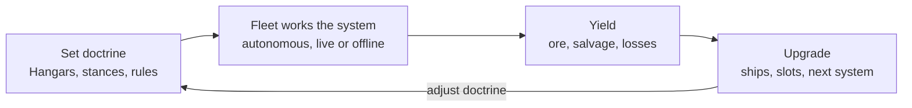
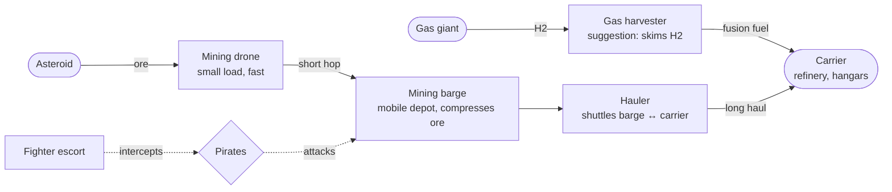
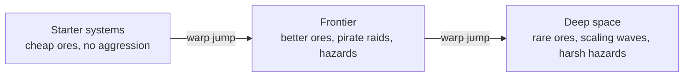

# Asteroid Fleet – Game Concept

> A browser idle game with autobattler setup in full 3D: as the admiral, you outfit a mining carrier's hangars, set stances and doctrine, and warp the carrier into ever richer and more dangerous star systems while the fleet works on its own. The page covers the concept, decisions so far, comparable games, the tech plan, and what is still open.

## Contents

- [Core fantasy](#core-fantasy)
- [Decisions so far](#decisions-so-far)
- [Direction: the endless field](#direction-the-endless-field)
- [Core loop](#core-loop)
- [Logistics chain: drone → barge → carrier](#logistics-chain-drone--barge--carrier)
- [Hangars as the autobattler board](#hangars-as-the-autobattler-board)
- [Stances & Doctrine](#stances--doctrine)
- [Ship types](#ship-types-proposal)
- [Zones & Progression](#zones--progression)
- [Carrier Power](#carrier-power)
- [Prestige & Research](#prestige--research)
- [Meta progression](#meta-progression-incremental-layer)
- [The gap in the market](#the-gap-in-the-market)
- [Reference games](#reference-games)
- [Tech: 3D in the browser with React Three Fiber](#tech-3d-in-the-browser-with-react-three-fiber)
- [Open questions for Lars](#open-questions-for-lars)

## Core fantasy

> **Player fantasy: you are the admiral, not the pilot.**
> You command a mining carrier and set doctrine: what goes into each hangar, which stance each ship takes, and a few simple rules. Then the fleet runs on its own: drones swarm out, barges become floating depots, fighters keep pirates away, and the carrier warps outward into richer, more dangerous systems.

## Decisions so far

| Topic | Decision |
| --- | --- |
| Direction | Open, near-endless field is the core |
| Intervention | No direct orders during play; the player sets doctrine like an admiral |
| Control levers | Hangar loadout, stances, and simple rules |
| Camera | Free 3D camera plus a tactical view, as a toggle or automatic zoom-out |
| Combat and progression | Safe starter systems; farther out, richer ores plus pirate waves and hazard zones |
| Carrier movement | Slow sublight repositioning within a system, warp jump between systems or zones |
| Warp back | The carrier can warp back to safer systems; ships outside the carrier at jump time are lost |
| Losses | Destroyed ships are gone for good; prestige upgrades can grant a minimum buffer per ship class that regenerates on a cooldown |
| Offline | Mostly safe: offline progress runs at reduced risk |
| Pirate scaling | Mostly by distance from the starter systems, plus a cargo-heat factor for ore held by the fleet and carrier |
| Carrier power | An energy pool for refinery, warp, and shields; recharges slowly from solar, later boosted by H2 fusion from gas giants |
| Prestige | A reset that pays a currency for a research tree: attribute and stat upgrades and/or per-ship-class upgrades |
| Prestige payout | One fixed, simple formula from ore value delivered and furthest zone reached |

## Direction: the endless field

| Direction | Role | Status |
| --- | --- | --- |
| Open, near-endless field (like Omen MiniMiner) | Core of the game | ✅ Chosen |
| Prestige with research tree | Long-term layer | ✅ Chosen |
| Short expeditions | Optional extra | Later |
| Asynchronous PvP raids | Possible later mode | Open |

Each star system is a persistent field that keeps refilling. The carrier works one system at a time and warps outward when the fleet is ready for richer ores and higher risk.

**Pros**

- Relaxed, runs in a tab or offline
- The fleet visibly grows into a big 3D swarm
- Fits idle and incremental habits

**Cons**

- Without player-shaped AI it gets frustrating, which is why stances and rules matter
- Needs depth from zones and hazards so it doesn't flatten out

## Core loop

The loop never resets on its own: you adjust doctrine whenever you like, and the fleet keeps working in between. There are no direct orders; the autobattler part is the setup.

## Logistics chain: drone → barge → carrier

Barges are the central idea. They move to rich clusters and take ore from the drones there, so drone trips stay short. Homeworld 2's Mobile Refinery and EVE Online's Orca and Rorqual work on the same principle.

$$
\text{Throughput} = \min(\text{mining rate},\ \text{drone transport},\ \text{barge capacity},\ \text{hauler transport},\ \text{refinery})
$$

The slowest link sets the income. That bottleneck puzzle is the optimization fun Factorio players know, at fleet scale.

- Barges are valuable, vulnerable targets: pirates go after full barges first, and all ore held out in the field raises cargo heat (see Pirate scaling).
- That gives fighters a clear job: escort barges instead of chasing anything in range.
- Rich clusters far out only pay off with a barge and an escort, a real risk-versus-reward call.
- A lost barge loses its cargo; a jettisoned container to salvage could be an upgrade.

## Hangars as the autobattler board

Hangar slots are the scarce resource everything revolves around, much like the board in The Bazaar. Each hangar has a fixed number of slots, neighbouring slots can trigger synergies, and each hangar has its own launch order.

| Mechanic | Example |
| --- | --- |
| Slot size | Drone 1 slot, fighter 2, barge 4 |
| Adjacency | Repair drone next to fighters: fighters heal when they dock |
| Hangar types | Launch bay (fast launch), dry dock (repairs), cargo bay (more storage) |
| Launch order | Fighters first, barge only once the zone is secured |
| Barge as mini-carrier | Big upgrade: a barge with its own drone slot |

## Stances & Doctrine

| Axis | Option | What it does automatically | Origin |
| --- | --- | --- | --- |
| Engagement | Aggressive | Chases any hostile in sensor range | Lars |
| Engagement | Defensive | Engages only hostiles attacking own ships or near the carrier | Lars |
| Engagement | Escort | Sticks to an assigned barge or hauler and attacks whatever attacks it | Lars |
| Engagement | Passive | Never engages, evades threats | Suggestion |
| Under fire | Stand ground | Keeps doing its job until destroyed | Lars |
| Under fire | Retreat at X % hull | Returns to the nearest hangar for repair below a threshold | Lars, threshold is a suggestion |
| Under fire | Retreat when cargo full | Miners and haulers unload first instead of risking the load | Suggestion |
| Mining | Greedy | Goes for the richest asteroids, even far out or in danger | Suggestion |
| Mining | Safe | Mines only inside escort or carrier cover | Suggestion |

Stances are the main control lever. Suggested scope, from broad to specific (the most specific wins):

1. Fleet-wide doctrine: the default for every ship, e.g. Defensive, Retreat at 30 % hull, Safe.
2. Per ship type: e.g. all fighters on Escort, all drones on Greedy.
3. Per hangar: overrides for one hangar's group, e.g. a strike hangar on Aggressive.

Stances set the default behaviour; rules are the exceptions. A rule fires on a condition and can switch a stance for a while, and it wins over the stance while it is active.

| Unit | When | Then |
| --- | --- | --- |
| All fighters | Pirate wave announced | Switch to Escort |
| Barge | Cargo above 80 % | Call a hauler |
| Barge | Pirate in range | Fall back to the carrier |
| Drone | Nearest asteroid farther than X | Unload at the nearest barge instead of the carrier |
| Hauler | No job | Park at the carrier |

## Ship types (proposal)

| Type | Role | Slots | Strength | Weakness |
| --- | --- | --- | --- | --- |
| Carrier | Base, refinery, hangars, warp drive | – | Heavy armor | Slow, barely armed |
| Mining drone | Mines ore | 1 | Cheap, numerous | Small load, fragile |
| Mining barge | Mobile depot, compresses | 4 | Shortens trips | Prime pirate target |
| Hauler | Barge ↔ carrier | 2 | Large cargo | Unarmed |
| Fighter | Escort, intercept | 2 | Fast, damage | Low endurance |
| Scout | Finds clusters and hazards | 1 | Reveals rich veins | Doesn't mine |
| Repair drone | Heals barges and fighters | 1 | Keeps the fleet alive | No yield |
| Gas harvester (suggestion) | Skims H2 from gas giants | 3 | Feeds fusion power | Slow, works far from cover |

Modules (laser, drill, tractor beam, shield, compressor) go into the ships, one or two module slots per type.

## Zones & Progression

| Zone | Ore value | Threats | Unlocks |
| --- | --- | --- | --- |
| Starter systems | Low, common ores | None | Drones, barges, haulers, first rules |
| Frontier | Medium | Occasional pirate raids, debris fields, solar storms | Fighters, engagement stances, repair drones |
| Deep space | High, rare ores | Scaling pirate waves, dangerous hazard zones | Advanced hangar types, deeper research |
| Gas giant systems | H2 instead of ore | Storms, pirates drawn to harvesters | Gas harvester, fusion reactor |

The three tiers and gas giants as an H2 source come from Lars; the specific threats and unlocks per zone are a proposal.

### Pirate scaling

- Distance: the main driver. The farther from the starter systems, the bigger and more frequent the waves.
- Cargo heat: ore held by barges, haulers, and the carrier raises the threat, which rewards hauling ore home and refining it quickly.
- Suggestion: refined goods or ore stored at a safe system count less, so greedy hoarding far out is a deliberate gamble.

### Carrier movement

| Movement | How it works | Origin |
| --- | --- | --- |
| Within a system | Slow sublight drift or repositioning toward richer clusters | Lars |
| Between systems or zones | Warp jump | Lars |
| Warp back | The carrier can jump back to safer systems | Lars |
| Ships outside at jump time | Lost | Lars |
| Jump cost | Energy from the carrier's power pool, plus a charge time before the jump | Energy: Lars; charge time: suggestion |
| Before a jump | An automatic recall during the charge time, so ships can dock before they are lost | Suggestion |
| Repositioning by doctrine | A carrier stance, e.g. follow the richest cluster or hold position | Suggestion |

The charge time is a vulnerable moment: in frontier and deep space a pirate wave during recall becomes a real test of the escort doctrine, and a panic jump costs every ship still outside.

## Carrier Power

The carrier runs on one energy pool. It recharges slowly from solar; the later goal is to harvest H2 from gas giants and burn it in fusion reactors for far more power.

| Side | Item | Origin |
| --- | --- | --- |
| Consumer | Refinery | Lars |
| Consumer | Warp drive | Lars |
| Consumer | Shields | Lars |
| Consumer | Hangar repair and relaunch | Suggestion |
| Consumer | Sublight drift | Suggestion |
| Source | Solar, slow; stronger near bright stars | Lars; star brightness is a suggestion |
| Source | Fusion reactor burning H2 from gas giants | Lars |
| Source | Reactor or capacitor upgrades in the research tree | Suggestion |

| Spend energy on | You gain | You give up |
| --- | --- | --- |
| Refining | Income, lower cargo heat | A slower warp charge, weaker shields |
| Shields | The carrier survives raids | Refining stalls, so cargo heat keeps rising |
| Warp | Reach richer systems or escape to safety | An empty pool on arrival: no shields, no refining for a while |

The trade-off table is a suggestion. The core tension: energy saved for an emergency jump is energy not spent on income or defence.

## Prestige & Research

A prestige resets the operation and pays out a research currency. Which parts reset and persist is a suggestion.

| Resets | Persists |
| --- | --- |
| Credits, ore, H2, and stored energy | Research currency and the research tree |
| Bought ships and modules | Unlocked ship classes and module blueprints |
| Bought hangar slots | Unlocked stances and rule conditions |
| Current system (back to a starter system) | Discovered systems as warp targets |

| Branch | Example upgrades |
| --- | --- |
| Logistics | Barge capacity, hauler speed, compression ratio |
| Mining | Mining yield, rare-ore chance, drone cargo |
| Combat | Fighter damage, armor, retreat repair speed |
| Carrier | Hangar slots, warp charge time, energy capacity and recharge, sublight speed |
| Reserves | Loss buffer per ship class: minimum size and rebuild cooldown |
| Per ship class | One small branch each for drone, barge, hauler, fighter, scout, repair drone |

All branch names and upgrades are suggestions.

| Model | Good | Risk |
| --- | --- | --- |
| Global tree only | Simple, every point helps the whole fleet | Little identity per ship class |
| Per-class upgrades only | Strong builds and specialisation | Points spread thin, weak early runs |
| ✅ **Hybrid (recommended)** | Global branches for basics, class branches for build identity | More UI and balancing |

Recommendation: the hybrid. The global branches carry the steady incremental growth, and the per-class branches feed into the hangar board, so a prestige can change which fleet composition is strongest.

### Loss buffer

Destroyed ships are gone for good. Prestige upgrades can grant a minimum buffer, for example per ship class: if the count drops below it, a replacement is rebuilt for free after a cooldown.

| Upgrade (suggestion) | Effect |
| --- | --- |
| Drone reserve | Keeps at least 4 mining drones, one rebuilt every 2 min |
| Fighter reserve | Keeps at least 2 fighters, one rebuilt every 5 min |
| Higher tiers | Larger minimum, shorter cooldown, more ship classes |

### Payout

Recommended formula (suggestion): research points from total ore value delivered to the carrier in the run, multiplied by the furthest zone tier reached (starter 1, frontier 2, deep space 3).

$$
\text{RP} = \left\lfloor \sqrt{\frac{\text{ore value delivered}}{1{,}000{,}000}} \right\rfloor \times \text{furthest zone tier}
$$

The square root keeps long runs from exploding the payout, and the zone multiplier rewards pushing outward over farming a safe system. The constants are placeholders for balancing.

## Meta progression (incremental layer)

1. In a system: ore becomes credits, which buy ships, modules, and hangar slots.
2. Outward: each warp jump opens richer ores together with tougher threats.
3. Idle: the current system keeps running offline at a reduced rate, settled from timestamps. Offline is mostly safe (Lars); suggested details: no pirate waves while away, and the fleet earns only what the current system's safe behaviour would yield.
4. Automation as a reward: unlock more stances, rule conditions, auto-buy, and auto-rebuild of losses, as Unnamed Space Idle does with its AI upgrades.
5. Prestige: reset for research currency and spend it in the research tree (see Prestige & Research).
6. Optional later: short expeditions into deep fields.

## The gap in the market

| Game | Does well | Missing |
| --- | --- | --- |
| Omen MiniMiner | Endless field, growing fleet, browser | Control over fleet behavior |
| Idle Fleet | Server-side idle, drones, player market | Fleet is just numbers, no tactics |
| Space Miner – Idle Adventures | Drones, research, prestige | Player control |
| Deep Space Mining Company | Live drone swarm in the browser | Control over the AI |
| Gladiabots | Rule building without code | No idle, no mining |
| Screeps Arena | Fully autonomous units | Real JavaScript, steep entry |
| The Bazaar, Super Auto Pets | Board building, synergies, async PvP | No logistics or space theme |

> So I was like, ok I have no control over any of this, and my units are actively making the worst possible decisions, which is a really bad combination.
>
> — u/TyaArcade on Deep Space Mining Company, r/incremental_games

> Upd. My Barge haven't brought a single ore piece in 10 minutes
>
> — Player comment on Mini Miner, itch.io

The gap: an endless-field idle game where you shape how the autonomous fleet behaves through hangars, stances, and simple rules, between plain idle numbers and Screeps-style code, and in 3D.

## Reference games

- [Omen MiniMiner](https://wompthecat.itch.io/omen-miniminer) (itch.io): endless field, growing mining fleet, playable in the browser
- [Idle Fleet](https://store.steampowered.com/app/4939470/Idle_Fleet/) (Steam): idle MMO with a mining fleet and 6 autonomous drones
- [Space Miner – Idle Adventures](https://store.steampowered.com/app/2679860/Space_Miner__Idle_Adventures/) (Steam): asteroid idle with drones and prestige
- [Little Asteroid Miner](https://store.steampowered.com/app/3848230/Little_Asteroid_Miner/) (Steam): incremental with AI drones and enemies
- [Unnamed Space Idle](https://store.steampowered.com/app/2471100/) (Steam): prestige and unlockable automation
- [Deep Space Mining Company](https://omiigames.itch.io/deep-space-mining-company) (itch.io): browser drone fleet, useful player feedback
- [Astronomics](https://astronomicsgame.com/) (astronomicsgame.com): asteroid mining automation with a bot crew and pirates
- [Gladiabots](https://store.steampowered.com/app/871930/) (Steam): build AI rules, robots fight on their own
- [Screeps: Arena](https://store.steampowered.com/app/1137320/Screeps_Arena/) (Steam): autonomous units scripted in JavaScript
- [Mindustry](https://store.steampowered.com/app/1127400/Mindustry/) (Steam): factory, units, and its own logic language
- [Super Auto Pets](https://store.steampowered.com/app/1714040/Super_Auto_Pets/) (Steam): autobattler with an asynchronous arena
- [The Bazaar](https://store.steampowered.com/app/1617400/The_Bazaar/) (Steam): board building with synergies, async PvP
- [Homeworld Remastered](https://store.steampowered.com/app/244160/) (Steam): mothership, collectors, Mobile Refinery, the 3D feel to aim for
- [Carrier Command 2](https://store.steampowered.com/app/1489630/) (Steam): a carrier launching autonomous units
- [EVE Online Rorqual](https://wiki.eveuniversity.org/Rorqual) (EVE University Wiki): capital mining ship with drones and compression

## Tech: 3D in the browser with React Three Fiber

> **Feasible.**
> A Homeworld-like 3D look with low-poly models runs well in the browser with React Three Fiber, three.js, and drei, as long as the many small objects are instanced and the simulation stays out of React.

| Aspect | Plan |
| --- | --- |
| Stack | TypeScript, React, React Three Fiber (`@react-three/fiber`), three.js, drei (`@react-three/drei`) |
| Many drones and asteroids | `InstancedMesh` (or drei `Instances`): one draw call per model type, thousands of objects, positions updated from the simulation each frame |
| Simulation | Deterministic, fixed tick (e.g. 10–20 Hz) with a seeded RNG in a Web Worker, fully separate from rendering; the renderer interpolates between the last two ticks |
| Camera | Free Homeworld-style camera (orbit, zoom, focus a ship) plus a tactical sensor view with icons; switch by toggle or automatically when zoomed far out |
| Look | Postprocessing via `@react-three/postprocessing`: bloom on engines and lasers, engine trails (drei `Trail` or instanced ribbons), dark skybox with a nebula |
| Distant objects | LOD (drei `Detailed`) and impostors or billboards for far asteroids and ships |
| Models | Low-poly from Blender or Kenney and Quaternius assets (free, CC0), loaded as glTF via drei `useGLTF` |
| Offline progress | Store a timestamp on close; on load, settle the elapsed time with a simplified income model instead of simulating every tick |
| Save state | IndexedDB, plus text export and import |

### Risks and limits

- Draw calls: every non-instanced mesh costs one; trails, lasers, and UI markers add up fast, so batch them as well.
- Mobile GPUs: bloom and many transparent trails are expensive; plan a low-quality mode and frame-rate cap from the start.
- React re-renders: per-frame updates must go through refs and `useFrame`, never React state, or performance collapses.
- UI overlay: hangar board, stance, rule, and research editors are better as normal HTML/React on top of the canvas than inside 3D; drei `Html` labels get expensive in large numbers.
- Worker boundary: send compact typed arrays (positions, states) per tick, not objects, to keep transfer cheap.
- Scope: free camera plus tactical view is two render modes; build the free camera first and add the tactical view as icons over the same scene.

### Libraries and assets

- [React Three Fiber](https://github.com/pmndrs/react-three-fiber) (github.com/pmndrs)
- [React Three Fiber docs](https://r3f.docs.pmnd.rs/) (r3f.docs.pmnd.rs)
- [drei](https://github.com/pmndrs/drei) (github.com/pmndrs): helpers for R3F (Instances, Detailed, Trail, useGLTF)
- [react-postprocessing](https://github.com/pmndrs/react-postprocessing) (github.com/pmndrs): bloom and other effects for R3F
- [three.js](https://threejs.org/) (threejs.org)
- [Kenney Space Kit](https://kenney.nl/assets/space-kit) (kenney.nl): free low-poly space models
- [Quaternius](https://quaternius.com/) (quaternius.com): free low-poly model packs

## Open questions for Lars

1. Energy at zero: can the pool run dry completely, and what happens then (shields drop, refining stops, the carrier is stranded until solar recharges)?
2. Is H2 also direct warp fuel, or does it only feed the fusion reactors that fill the energy pool?
3. Loss buffer and offline: do reserve ships keep rebuilding on their cooldown while you're away, or only while the game is open?
4. How deep should the rules go next to stances: fixed rule cards, Gladiabots-style building blocks, or real scripting like Screeps?
